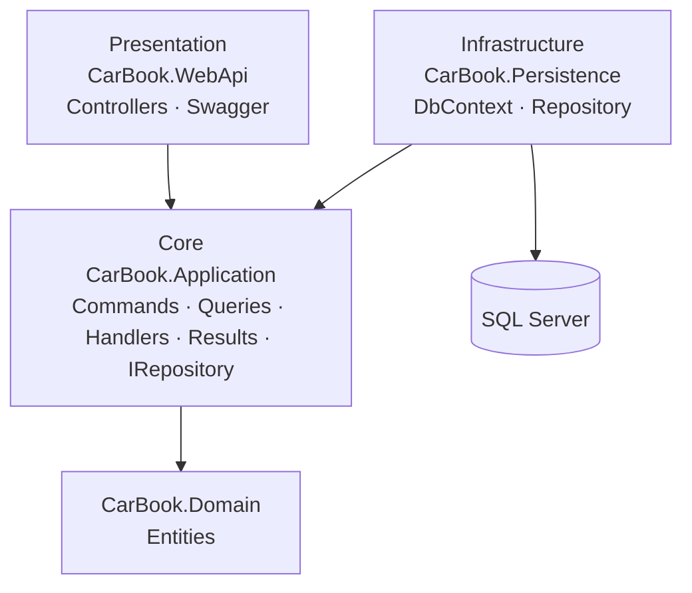
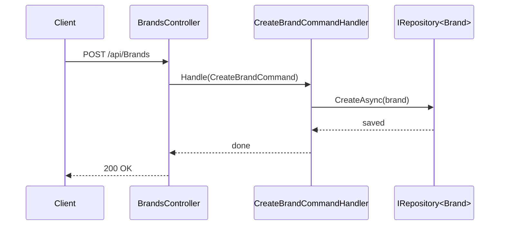

# 🚙 CarBook — Car Rental API

A car rental backend built with **ASP.NET Core 8**, following **Onion Architecture** and the **CQRS** pattern. It covers the data a car rental site needs: cars with brands, prices, features and descriptions, plus locations, services, testimonials and site content.

## ✨ Highlights
- **Onion Architecture** — Domain, Application, Persistence and WebApi are separate projects with dependencies pointing inward
- **CQRS** — every operation is split into a Command or Query with its own Handler and Result model (implemented by hand, without MediatR)
- **Generic repository** — a single `IRepository<T>` interface and implementation shared by all entities, plus small dedicated repositories for queries that join tables (cars with brands, prices with cars)
- **Clear responses** — unknown ids return `404 Not Found`; references to a missing brand, car, feature or pricing type return `400 Bad Request`
- **EF Core + SQL Server** with Code First
- **Swagger** for interactive API documentation

## 🏗️ Architecture



### Request flow (CQRS)



## 📦 Modules

All 16 tables are exposed through the API.

| Module | Route | Operations |
|---|---|---|
| About | `/api/Abouts` | CRUD |
| Banner | `/api/Banners` | CRUD |
| Brand | `/api/Brands` | CRUD |
| Car | `/api/Cars` | CRUD (with brand name), latest cars |
| Car pricing | `/api/CarPricings` | List with car and pricing type, by car, create / update / delete |
| Car feature | `/api/CarFeatures` | By car, create, toggle availability, delete |
| Car description | `/api/CarDescriptions` | By car, create / update / delete |
| Category | `/api/Categories` | CRUD |
| Contact | `/api/Contacts` | CRUD (send date is set by the server) |
| Feature | `/api/Features` | CRUD |
| Footer address | `/api/FooterAddresses` | CRUD |
| Location | `/api/Locations` | CRUD |
| Pricing | `/api/Pricings` | CRUD (pricing types such as daily, weekly) |
| Service | `/api/Services` | CRUD |
| Social media | `/api/SocialMedias` | CRUD |
| Testimonial | `/api/Testimonials` | CRUD |

CRUD modules expose:

| Method | Endpoint |
|---|---|
| GET | `/api/{module}` |
| GET | `/api/{module}/{id}` |
| POST | `/api/{module}` |
| PUT | `/api/{module}` |
| DELETE | `/api/{module}?id={id}` |

Car-specific endpoints:

| Method | Endpoint | Description |
|---|---|---|
| GET | `/api/Cars/Last?count=5` | Most recently added cars, with brand name |
| GET | `/api/CarPricings` | Every car price with brand, model and pricing type |
| GET | `/api/CarPricings/ByCar/{carId}` | Prices of one car |
| GET | `/api/CarFeatures/ByCar/{carId}` | Features of one car and whether each is available |
| PUT | `/api/CarFeatures` | Change a feature's availability (`carFeatureID`, `available`) |
| GET | `/api/CarDescriptions/ByCar/{carId}` | Description of one car |

## 🛠️ Tech Stack
C# · ASP.NET Core 8 Web API · Entity Framework Core · SQL Server · Swagger

## 🚀 Getting Started

1. Set `ConnectionStrings:DefaultConnection` in `Presentation/CarBook.WebApi/appsettings.json`
2. Apply migrations and run:

```bash
dotnet ef database update --project Infrastructure/CarBook.Persistence --startup-project Presentation/CarBook.WebApi
dotnet run --project Presentation/CarBook.WebApi
```

Swagger UI: `https://localhost:<port>/swagger`
