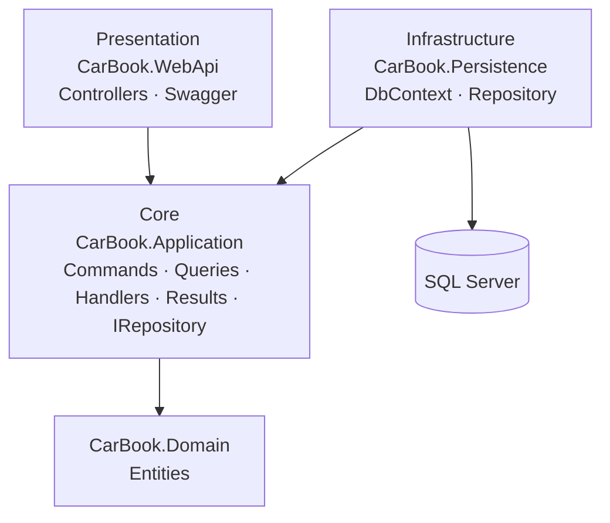
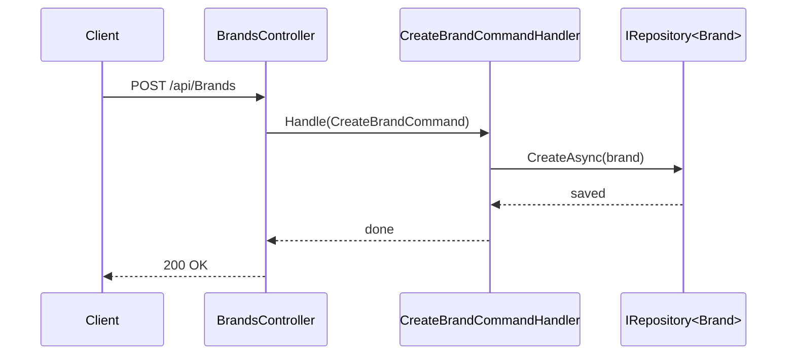

# 🚙 CarBook — Car Rental API

> 🚧 **Work in progress** — the architecture is in place and new modules are being added.

A car rental backend built with **ASP.NET Core 8**, following **Onion Architecture** and the **CQRS** pattern. The goal is a full car rental platform (cars, pricing, locations, features, testimonials); the core layers and the first modules are complete.

## ✨ Highlights
- **Onion Architecture** — Domain, Application, Persistence and WebApi are separate projects with dependencies pointing inward
- **CQRS** — every operation is split into a Command or Query with its own Handler and Result model (implemented by hand, without MediatR)
- **Generic repository** — a single `IRepository<T>` interface and implementation shared by all entities
- **EF Core + SQL Server** with Code First
- **Swagger** for interactive API documentation

## 🏗️ Architecture



### Request flow (CQRS)



## 📦 Modules

| Module | Status |
|---|---|
| About | ✅ Full CRUD (CQRS) |
| Banner | ✅ Full CRUD (CQRS) |
| Brand | ✅ Full CRUD (CQRS) |
| Car, Pricing, Location, Feature, Category, Service, Testimonial, Contact, Social Media | 🧱 Entities ready, endpoints in progress |

Each completed module exposes:

| Method | Endpoint |
|---|---|
| GET | `/api/{module}` |
| GET | `/api/{module}/{id}` |
| POST | `/api/{module}` |
| PUT | `/api/{module}` |
| DELETE | `/api/{module}?id={id}` |

## 🛠️ Tech Stack
C# · ASP.NET Core 8 Web API · Entity Framework Core · SQL Server · Swagger

## 🚀 Getting Started

1. Update the connection string in `Infrastructure/CarBook.Persistence/Context/CarBookContext.cs`
2. Apply migrations and run:

```bash
dotnet ef database update --project Infrastructure/CarBook.Persistence --startup-project Presentation/CarBook.WebApi
dotnet run --project Presentation/CarBook.WebApi
```

Swagger UI: `https://localhost:<port>/swagger`
